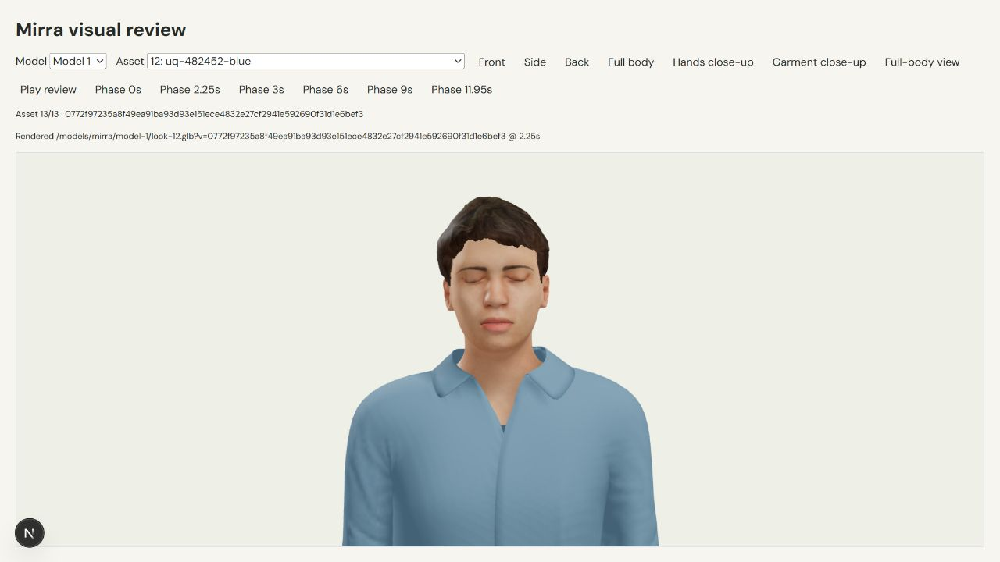
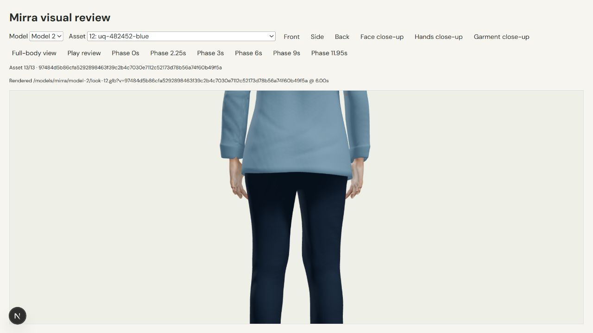

# Mirra independent visual review

Reviewed 2026-10-18 in this reviewer's own actual browser tabs at `http://127.0.0.1:3000/review-mirra` and the main app, using the existing 1280 x 720 viewport. No application/assets were edited by this reviewer. No Gemini or voice calls were made. Screenshots are in the browser tool transcript, with six selected final evidence JPEGs saved under `docs/mirra-evidence/` after authorization was extended to evidence files.

## Final disposition

**No remaining P1/P2 asset defect was visible in the completed coverage below.** Both models now have human proportions, aligned legs, planted shoes, relaxed arms beside the torso, plausible wrists/fingers, visible faces/eyes, and continuous garment silhouettes. The initial bowed-leg, pointed-cuff, torso-layering, sleeve-penetration, hidden-hand, and missing-blink defects were repaired and visually rechecked.

This is a visual clearance of the inspected views and animation samples, not physical-fit validation. It is also not a claim that every frame of every 12-second clip was watched continuously. Browser tooling supplies still screenshots. Every one of the 26 current assets was played from phase 0 through at least one full 12-second cycle, with start, approximately 6.1-second, and approximately 12.5-second screenshot samples. The asset collection also received the frozen-phase checks below. The implementing agent separately reports an actual AnimationMixer check of all 26 eyelid tracks/endpoints and zero foot drift; that technical evidence supplements these visual observations.

## Coverage and evidence

- Model 1: all eight outfit combinations and all five individual previews received Front at 0s, Side at 6s, and Back at 11.95s on the structurally final body/garment meshes. Those exports then changed only to restore facial animation; every current hash below was individually rechecked in face close-up at the 2.25s blink peak. All 13 close their eyelids correctly. Representative final overshirt received live playback samples and endpoint comparison.
- Model 2: all 13 current hashes below received Front at 0s, Side at 6s, Back at 11.95s, and Front face close-up at 2.25s. Every blink closes correctly. Final overshirt look-12 additionally received Back Hands close-up at 6s, Front Garment close-up at 6s, and live playback samples spanning more than 12 seconds. Final layered look-1 also received hand close-ups. Previous skin sliver above the inner cuff is gone.
- Both models' representative faces were inspected at 0, 2.25, 3, 6, 9, and 11.95s during the repair review. Subtle head/upper-torso motion and closed-eye blink were visible. Final current hashes received the explicit blink checks above. No obvious loop pop, sliding feet, tearing, hollow body, rigid A/T pose, or deformed fingers was observed in the sampled evidence.
- Main app: inspected at 1280 x 720. Refined serif headings, restrained palette, product cards, and whitespace create a polished overall composition. A compact-height stage/pagination overlap and faint auxiliary text were reported. The implementing agent is addressing that CSS separately after this asset review; this reviewer has not cleared the subsequent CSS revision.

The review harness originally could leave a paused phase unapplied and rapid captures could show loading/previous-camera frames. Those captures were excluded from clearance, and the implementing agent repaired phase selection/invalidation and added rendered asset/hash/phase acknowledgment. Final checks used settled rendered states. Hot reloads reset selection during review; interrupted checks were resumed explicitly.

## Remaining low-priority polish

1. **P3: Model 2 neck inset looks striped in close-up.** On blue overshirt + tee combinations (look-1/3/5/7), Front face close-up at 2.25s or 6s shows thin horizontal tee/skin/gray strips at the bottom of the neck opening instead of a clean inset. This is small at the normal studio camera and is not an obvious hole or blocker. Reproduce on Model 2 look-5 hash `01225072942fab901abe3800a643b3bb4b4e9a8521a1c4fe973dfaf91eebd6b1`.
2. **P3: facial rendering remains somewhat waxy/low-detail.** Faces and eyes are anatomically plausible, but close-up material detail could be improved for realism. This does not block the present prototype quality.

## Resolved defects and regression history

- Initial Model 1 look-0 `bb0b97bea6ec3f4755470bc29c7a23c24f4c904640aafd865f262a81592a9d7d` and Model 2 look-0 `92277d8287bfffe4c979729f7f78b0a561087e83c41caf5449e9f2a4fc5266a3`: severe outward-bowed knees and pointed trouser tabs. Direct leg alignment fixed stance and cuffs.
- Initial Model 1 layered look-1 `dc506e989a5b03f0be80ce2835c2fce6a07ae673833bb8546d07f2d68bc48728`: white lower-back block and hem puncture. Initial black layered look-5 `605248b37760e78fcc190d0cc76c5a3b334df08ee66dba1a593c2f2aeba6f1ff`: round black abdomen hole and vertical hem tear. Initial Model 2 layered look-1 `022b9406e58220096bff677139be33223d3a085b506375b4262a19e88303c83c`: floating high hem, white lumbar block and mid-back slit. Replacing the welded/cropped shirt construction and masking hidden layers resolved these.
- Intermediate Model 1 `254198bb9bcaf603cf1243505bd98bfc9d2a3f64faddf40290c117bebd32db6d`: white rear-collar patch and inner-forearm skin strips. Final representative `173c6520152729b48725fce876d765f454e246be82740cfaab205b60a5c995b3` resolves them.
- Intermediate Model 2 `4891047d807a19a16db78beeef390fa2b2ecb9e483dfb612d56b64254f57d4ae`: overlong sleeves concealed hands. Shortening cuffs alone (`15e70b95e45144189d40a259bf3fb1cf6e0d0d8d7e6914676ee1b48992b38e8a`) exposed hand/torso-hem intersection. Revised hand clearance (`10ae9a11a4f875de15396b46748e578a872253bb665263a379c729ec7a1530f3`) restored wrists/hands but retained a small cuff skin sliver. Final cuff/body mask removes that sliver.
- A batch export regression left overshirt variants open-eyed at the supplied blink peak, including Model 1 old look-12 `c1c8d65036cf6b407fa25620bd9d81957c175915bee72198a4ae08c8008cb59b`. The implementing agent independently confirmed that body-mask baking detached the original facial action and failed to restore it. Restoring action/slot/values repaired the export. Every current asset below was visually checked with closed eyelids at 2.25s.

## Exact final reviewed hashes

Rows use `/models/mirra/<model>/look-<n>.glb`. Look 0-7 are the eight combinations; look 8 white tee, 9 black tee, 10 navy chinos, 11 olive chinos, and 12 blue overshirt are the five individual previews. The static Model 1 clearance carries forward only because the final reexport restored facial tracks without changing its inspected body/garment construction.

| Model | Look | SHA-256 |
| --- | --- | --- |
| model-1 | look-0 | e2a77ef13b855625e699cc8790e4fed00d6f470eee4aabad629a4815ec07a1dd |
| model-1 | look-1 | 173c6520152729b48725fce876d765f454e246be82740cfaab205b60a5c995b3 |
| model-1 | look-2 | f9408401d52e73f2fff3dafe0921c1369b4e67dfbbf05620b158a1c02d9b1cf0 |
| model-1 | look-3 | 4f0997fbcb809eab30312247cc50d090cad5a01ce764acf3e8f1ecd2b10ef326 |
| model-1 | look-4 | da87c406157fbab65e7a95383c17516fe93fd91f089d8cb4afa500174091bd9f |
| model-1 | look-5 | b4bd8ae14c0aba3a58ad7a356b252251deac16d10db00532ac586144f1010df6 |
| model-1 | look-6 | 2c5b092cfd8744eceae3a74e5d941b61e89fa792a3f267a9bfc568cfb82e0371 |
| model-1 | look-7 | 9dcc8e22744e77a64952693bdda06335a72ee84eeb0a30751cde5241afef286b |
| model-1 | look-8 | 5bdd181f15baa089d03d3ac3ddc5e4b0872524141d2648c677cd6ed49b6d8fc9 |
| model-1 | look-9 | d74b43d3ff5b62bd3fc8a99d4d5c1302142e78c5d67e9f86212fdf3df10b755b |
| model-1 | look-10 | b99a9c5ab6bb6bc37efb8a9af552f3473cf73e794b9b871f78007a797dd60505 |
| model-1 | look-11 | 9b896c6936946bccdc2759258f683f45b8415f47d28cd665c2dc3a495c941c0a |
| model-1 | look-12 | 0772f97235a8f49ea91ba93d93e151ece4832e27cf2941e592690f31d1e6bef3 |
| model-2 | look-0 | c33747a32b4ce8b3eaa83d3a85c9fe69f71154c031a06d5055c6a7d55c7f4a4d |
| model-2 | look-1 | 92656d680032e84067c8c110167cc88855814c0ccdc0254cc915bc91aea8d973 |
| model-2 | look-2 | 297d4507a37fb13603fed2951bdf833b88ad456955042c52517e86750bf196b3 |
| model-2 | look-3 | 14745766d46bb13013921fa99dbf4ed378940f5a8f40b2065df309671274a198 |
| model-2 | look-4 | c7879113ef65d8649cfe1386643877d2657013385c6e3402161c3e0756728bbd |
| model-2 | look-5 | 01225072942fab901abe3800a643b3bb4b4e9a8521a1c4fe973dfaf91eebd6b1 |
| model-2 | look-6 | 882a88a69597400178c8631c6dfad9fb21ac7cdc048051423e81c2e7638a27a5 |
| model-2 | look-7 | a48035bd4fe9203d39d1170966bd89bf82587bd96869613743536cd0dcce3521 |
| model-2 | look-8 | 6284b44c7677b09885c433925f55b87f06744b7f0983488bc626285641bf98b2 |
| model-2 | look-9 | a36f6f7c1cb230d242743148429b33d3749e03a4db696ee323f9f66414fab0ab |
| model-2 | look-10 | d94992ba6fe6c12a3bb553b6ef07714b2b6559a8251b230984b63bd723c9bdd7 |
| model-2 | look-11 | 02b96b338c6a5cd7514b05cf15fd6abe8c50a0b02229cdede49b8d8f9aef4c65 |
| model-2 | look-12 | 97484d5b86cfa5292898463f39c2b4c7030e7112c52173d78b56a74f60b49f5a |

## Completed live playback audit: all 26 current assets

Each row ran in Front full-body view from acknowledged frozen phase 0, then Play review. Screenshot samples were captured at start, approximately 6.1 seconds, and approximately 12.5 seconds after playback began, across the 12-second boundary. The duration below includes completion of the final screenshot. Model 1 look-9's last screenshot took longer to return; its final sample was requested at 12.546 seconds and completed at 15.546 seconds. No abrupt endpoint change, foot sliding, new interpenetration, hollow body, or pose defect was visible in these samples. The test observes spaced frames across a full real-time cycle, not every intermediate frame.

| Model | Look | Live duration observed (seconds) | Result |
| --- | --- | --- | --- |
| model-1 | look-0 | 12.756 | No defect visible in samples |
| model-1 | look-1 | 12.846 | No defect visible in samples |
| model-1 | look-2 | 12.835 | No defect visible in samples |
| model-1 | look-3 | 12.759 | No defect visible in samples |
| model-1 | look-4 | 12.802 | No defect visible in samples |
| model-1 | look-5 | 12.793 | No defect visible in samples |
| model-1 | look-6 | 12.752 | No defect visible in samples |
| model-1 | look-7 | 12.7 | No defect visible in samples |
| model-1 | look-8 | 12.687 | No defect visible in samples |
| model-1 | look-9 | 15.546 | No defect visible in samples |
| model-1 | look-10 | 12.685 | No defect visible in samples |
| model-1 | look-11 | 12.725 | No defect visible in samples |
| model-1 | look-12 | 12.776 | No defect visible in samples |
| model-2 | look-0 | 12.866 | No defect visible in samples |
| model-2 | look-1 | 12.832 | No defect visible in samples |
| model-2 | look-2 | 12.783 | No defect visible in samples |
| model-2 | look-3 | 12.765 | No defect visible in samples |
| model-2 | look-4 | 12.757 | No defect visible in samples |
| model-2 | look-5 | 12.705 | No defect visible in samples |
| model-2 | look-6 | 12.757 | No defect visible in samples |
| model-2 | look-7 | 12.801 | No defect visible in samples |
| model-2 | look-8 | 12.805 | No defect visible in samples |
| model-2 | look-9 | 12.854 | No defect visible in samples |
| model-2 | look-10 | 12.832 | No defect visible in samples |
| model-2 | look-11 | 13.325 | No defect visible in samples |
| model-2 | look-12 | 12.758 | No defect visible in samples |

## Saved final evidence

These are actual browser screenshots, without image editing. Both models' look-12 hashes are visible in their controls/status.

- [Model 1 final body](mirra-evidence/model-1-final.jpg)
- [Model 1 restored closed-eye blink](mirra-evidence/model-1-blink.jpg)
- [Model 1 relaxed hand and wrist](mirra-evidence/model-1-hands-side.jpg)
- [Model 2 after full live cycle](mirra-evidence/model-2-full-cycle.jpg)
- [Model 2 closed-eye blink](mirra-evidence/model-2-blink.jpg)
- [Model 2 corrected cuff coverage and hands](mirra-evidence/model-2-hands-back.jpg)
- [Exact live-cycle durations](mirra-evidence/live-cycle-log.json)

